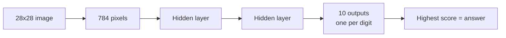

<p align="center">
  
</p>

<p align="center">
  
</p>

<p align="center">
  
  
  
</p>

## What is this?

The model looks at an image of a handwritten digit (0 to 9) and says which digit it is.

I built it **two times** to learn how neural networks really work:

1. **From scratch with NumPy**: I wrote the forward pass, backpropagation and gradient descent myself.
2. **With Keras**: the same idea in a few lines.

Data: **EMNIST Digits** (28 × 28 pixel images).

## Results

| Version | Test accuracy |
|---------|:-------------:|
| NumPy (from scratch) | 92.6% |
| Keras | **95.8%** |

## How it works



**NumPy version**
- Sigmoid activation
- Mini-batch gradient descent
- 1500 epochs

**Keras version**
- 2 hidden layers with 64 neurons each (ReLU)
- Softmax output, Adam optimizer
- 10 epochs

## Files

| File | What is inside |
|------|----------------|
| `emnist_digits_(Numpy).ipynb` | Neural network from scratch |
| `emnist_digits_(Keras).ipynb` | Same task with Keras |

## How to run

```bash
pip install numpy pandas matplotlib scikit-learn tensorflow
```

Download the EMNIST Digits CSV files from [Kaggle](https://www.kaggle.com/datasets/crawford/emnist), then open a notebook and run all cells.

<p align="center">
  
</p>
